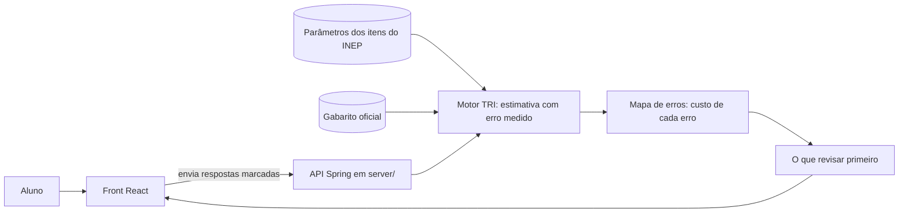

# Arquitetura

> **Rascunho.** Ainda não há código. Os blocos marcados como *proposta* dependem de a peça A (mapa de erros) ser confirmada e de decisões ainda não tomadas. Ao decidir, registre em `docs/decisions/` e ligue aqui.

## Stack já decidida
| Parte | Escolha | Decisão |
|---|---|---|
| Back-end | Java 21 + Spring Boot 4.1.2, em `server/` | [0001](decisions/0001-java-21-spring-boot-4-1.md) |
| Front | React + Tailwind, na raiz do repositório | [0002](decisions/0002-front-na-raiz-java-em-server.md) |
| Cálculo da TRI | Na API Spring, que não armazena as respostas | [0003](decisions/0003-onde-roda-o-calculo-e-privacidade.md) |
| Arquitetura do Back-end | Motor TRI 3PL (EAP) + Catálogo em memória em `server/` | [0006](decisions/0006-arquitetura-e-plano-backend-java-tri.md) |
| Hospedagem, leitura por foto | **a decidir** | |

## Fluxo principal (proposta)


## Núcleo e camadas (proposta)
O núcleo nunca sai. Se o prazo apertar, corta-se das camadas de fora para dentro (regra de corte do `AGENTS.md`).

```mermaid
flowchart TB
  subgraph Camadas externas, cortadas primeiro
    X1[Acessibilidade: voz, alto contraste, texto simples]
    X2[Entrada por voz]
    X3[Entrada por foto do cartão-resposta]
  end
  subgraph Núcleo, nunca sai
    N1[Entrada por tabela manual]
    N2[Motor TRI]
    N3[Mapa de erros]
    N4[O que revisar primeiro]
  end
  N1 --> N2 --> N3 --> N4
  X1 -.-> N4
  X2 -.-> N1
  X3 -.-> N1
```

## Em aberto
- Onde a API fica no ar e como é o deploy (CD). Testar cedo.
- Como será a leitura por foto, se entrar.
