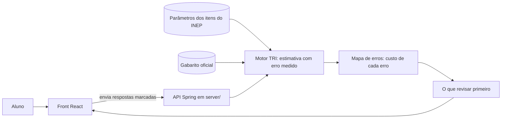

# Arquitetura

> **Rascunho.** Ainda não há código. Os blocos marcados como *proposta* dependem de a peça A (mapa de erros) ser confirmada e de decisões ainda não tomadas. Ao decidir, registre em `docs/decisions/` e ligue aqui.

## Stack já decidida
| Parte | Escolha | Decisão |
|---|---|---|
| Back-end | Java 21 + Spring Boot 4.1.2, em `server/` | [0001](decisions/0001-java-21-spring-boot-4-1.md) |
| Front | React + Tailwind, na raiz do repositório | [0002](decisions/0002-front-na-raiz-java-em-server.md) |
| Cálculo da TRI | Na API Spring, que não armazena as respostas | [0003](decisions/0003-onde-roda-o-calculo-e-privacidade.md) |
| Hospedagem, dados, leitura por foto | **a decidir** | |

## Fluxo principal (proposta)


## Núcleo e camadas (proposta)
O núcleo nunca sai. Se o prazo apertar, corta-se das camadas de fora para dentro (regra de corte do `AGENTS.md`).

```mermaid
flowchart TB
  subgraph Camadas externas, cortadas primeiro
    X1[Acessibilidade: voz, alto contraste, texto simples]
    X2[Entrada por voz]
    X3[Entrada por foto do cartão-resposta]
  end
  subgraph Núcleo, nunca sai
    N1[Entrada por tabela manual]
    N2[Motor TRI]
    N3[Mapa de erros]
    N4[O que revisar primeiro]
  end
  N1 --> N2 --> N3 --> N4
  X1 -.-> N4
  X2 -.-> N1
  X3 -.-> N1
```

## Em aberto
- Onde os dados do INEP ficam: arquivo carregado na subida da API (sem banco) ou banco. Impacta a hospedagem.
- Onde a API fica no ar e como é o deploy (CD). Testar cedo (decisão `0003`, a criar).
- Como será a leitura por foto, se entrar.

## API do núcleo (implementada)
`POST /api/analysis` (endpoint stateless, decisão [0003](decisions/0003-onde-roda-o-calculo-e-privacidade.md)). Recebe as 45 respostas e devolve nota estimada, erro, mapa de erros e a lista "revise primeiro". Não grava e não registra em log o que recebeu.

```mermaid
sequenceDiagram
  participant F as Front React
  participant A as API Spring
  participant M as Motor TRI (em memória)
  F->>A: POST /api/analysis {"answers": "45 letras"}
  A->>A: valida o formato (A-E ou ponto)
  A->>M: analyze(respostas)
  M-->>A: nota, erro, mapa de erros
  A-->>F: JSON (notice, exam, score, error, errorMap, reviewFirst)
  Note over A: nada é gravado; nenhum log do conteúdo
```

Entrada: `{"answers": "CBDC..."}`, 45 caracteres, letras A a E (ou `.` para branco), na ordem da prova (posições 136 a 180). Resposta: `notice`, `exam`, `score`, `error`, `errorMap` (ordenado do custo maior ao menor), `reviewFirst` (os 5 primeiros do mapa). Entrada inválida: HTTP 400 com mensagem fixa.
