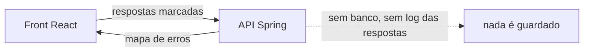
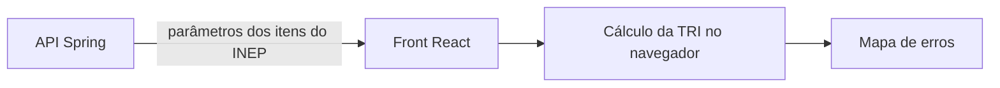

# 0003: onde roda o cálculo da TRI e o que dizemos sobre privacidade

- **Data:** 05/11/2026
- **Quem participou:** Gabriel e Murilo (a decidir)
- **Estado:** **PENDENTE.** Escolher uma das opções abaixo antes de afirmar qualquer coisa de privacidade no README, no vídeo ou na página.

## Problema
O README diz que os dados do aluno ficam só no aparelho e que nenhum dado é enviado a servidores. Mas o desenho atual (`docs/arquitetura.md`) manda as respostas marcadas para a API Spring em `server/`. As duas coisas não podem ser verdade ao mesmo tempo, e o jurado pode apontar isso.

Observação sobre a regra citada: o item 6.9 do regulamento diz que a **demo não pode expor dados pessoais reais de terceiros**. Ele não exige que nenhum dado saia do aparelho. Então a frase "Privacidade por Design (Regra 6.9)" mistura duas coisas.

## Ação
Ainda não escolhida. Ver alternativas.

## Alternativas consideradas (trade-offs)

**Opção A: o cálculo roda na API, e a API não guarda nada (stateless)**

- Vantagem: aproveita o Java no núcleo (critério de implementação) e mantém a lógica num lugar só.
- Trade-off: as respostas **viajam** até o servidor. O texto precisa dizer isso com precisão ("a API calcula e não armazena") e o código precisa ser verificável (sem persistência e sem log das respostas).

**Opção B: o cálculo roda no navegador, a API só entrega os dados dos itens do INEP**

- Vantagem: "as respostas do aluno nunca saem do aparelho" é uma afirmação mais forte e fácil de provar. A demo continua funcionando mesmo se a API ficar lenta.
- Trade-off: a lógica de cálculo fica no front (JavaScript), e a API em Java passa a ter um papel menor na demo.

**Opção C: híbrida (cálculo no navegador, e a API faz o mesmo cálculo para testes e validação)**
- Vantagem: privacidade forte no uso real e arquitetura visível para o jurado.
- Trade-off: a lógica existe em duas linguagens, o que dobra o trabalho de manter e de testar.

## Recomendação (do Gabriel, a confirmar com o Murilo)
Opção A, se o Murilo conseguir garantir no código que nada é guardado. Heurísticas do fluxo: 1 (núcleo na stack que a pessoa domina) e 2 (demo no ar vale mais). Se a hospedagem da API se mostrar instável no teste (decisão de deploy), mudar para a opção B, que tem menos risco de a demo não abrir.

## Colaboração
Levantado pelo Gabriel ao revisar o README do Murilo.

## Resultado com evidência
Ainda não medi. Como medir: depois de escolher, conferir no código que não há persistência nem log das respostas (opção A), ou que nenhum pedido à API leva respostas do aluno (opção B), e anotar o resultado aqui.

## Aprendizado
A preencher depois da decisão.
