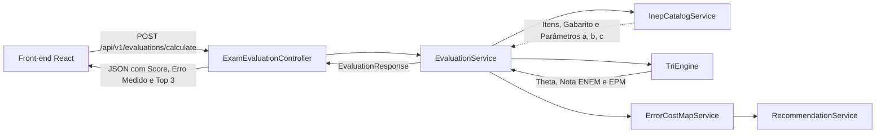

# 0009: Arquitetura e Plano de Implementação do Back-end Java (TRI e Mapa de Erros)

- **Data:** 10/11/2026
- **Quem participou:** Murilo (durante dsenvolvimento)
- **Estado:** **PROPOSTA para implementação**. Define a estrutura de classes, motor TRI, catálogo em memória e estratégia de escalabilidade e manutenção.

## Problema
O estudante da rede pública que se prepara para o ENEM de forma autodidata enfrenta a opacidade da Teoria de Resposta ao Item (TRI). Ele precisa saber não apenas quantos itens errou, mas o **custo real em pontos de cada erro** e quais os **3 temas de maior impacto** para direcionar seu tempo escasso de revisão.

Para atender aos requisitos do evento e garantir utilidade máxima ao aluno, o back-end em Java 21 + Spring Boot 4.1.2 precisa:
1. Calcular a proficiência e o Erro Padrão de Medida (EPM) de forma confiável em menos de 100ms;
2. Ser estritamente *stateless* (sem estado em banco e sem retenção de dados do aluno), respeitando a privacidade (Regra R3 e Decisão 0003);
3. Permitir fácil manutenção (ex.: adicionar novos anos e cadernos do ENEM sem alterar código) e escalabilidade horizontal simples em hospedagens gratuitas (Render/Railway/Fly.io).

## Ação
Implementar o back-end no módulo `server/` sob o pacote `br.com.paideia.*`, dividindo a solução em serviços desacoplados e records imutáveis:



### 1. Estrutura de Pacotes e Responsabilidades
```
server/src/main/java/br/com/paideia/
├── PaideiaBackendApplication.java
├── config/
│   ├── CorsConfig.java                      // Configuração de CORS para o front
│   └── InepDataInitializer.java             // Carregamento de dados no boot
├── controller/
│   ├── ExamEvaluationController.java        // POST /api/v1/evaluations/calculate
│   └── InepCatalogController.java           // GET /api/v1/exams e metadados
├── domain/
│   ├── enums/
│   │   ├── KnowledgeArea.java               // HUMANAS, NATUREZA, LINGUAGENS, MATEMATICA
│   │   └── BookletColor.java                // AZUL, AMARELO, BRANCO, ROSA, etc.
│   └── model/
│       ├── InepExam.java                    // Exame (ano, área, itens)
│       ├── InepItem.java                    // Item (num, parâmetros a, b, c, gabarito, habilidade)
│       ├── TriScore.java                    // Proficiência (theta, nota ENEM, margem de erro)
│       └── QuestionImpact.java              // Impacto individual de cada questão
├── dto/
│   ├── request/
│   │   ├── EvaluationRequest.java           // Payload de submissão do simulado
│   │   └── StudentAnswerItem.java           // Resposta de uma questão (num, alternativa)
│   └── response/
│       ├── EvaluationResponse.java          // Resposta completa com score, erro e recomendações
│       ├── QuestionImpactDto.java           // Detalhe de perda de pontos por questão
│       ├── TopicRecommendationDto.java      // Top 3 temas ranqueados por potencial de ganho
│       └── InepExamSummaryDto.java          // Resumo dos cadernos disponíveis
├── exception/
│   ├── GlobalExceptionHandler.java          // Tratamento centralizado de erros (400, 404, 500)
│   ├── ExamNotFoundException.java
│   └── InvalidAnswerException.java
└── service/
    ├── InepCatalogService.java              // Catálogo em memória indexado
    ├── EvaluationService.java               // Orquestrador do fluxo de avaliação
    ├── TriEngine.java                       // Motor matemático TRI (3PL + EAP)
    ├── ErrorCostMapService.java             // Simulação marginal de perda por erro
    └── RecommendationService.java           // Agrupamento e ranqueamento dos top 3 tópicos
```

### 2. Motor Matemático TRI (3PL + Estimador EAP)
- **Modelo 3PL (*3-Parameter Logistic*):**
  $$P_i(\theta) = c_i + \frac{1 - c_i}{1 + \exp(-D \cdot a_i (\theta - b_i))}$$
  com $D = 1.0$, $a_i$ (discriminação), $b_i$ (dificuldade) e $c_i$ (acerto casual/chute).
- **Estimador EAP (*Expected A Posteriori*):**
  Calculado via quadratura de Gauss-Hermite (40 nós uniformemente espaçados em $[-4, 4]$) com distribuição *a priori* $\mathcal{N}(0, 1)$. Evita divergências numéricas presentes no MLE (*Maximum Likelihood Estimation*) quando o estudante acerta 0% ou 100% dos itens.
- **Escala Oficial ENEM:**
  Transformação linear $\text{Nota} = 500 + 100 \cdot \hat{\theta}$.
- **Erro Padrão de Medida (EPM):**
  Derivado diretamente do desvio padrão da distribuição *a posteriori*, retornado obrigatoriamente junto à nota estimada (Regra R5 do `AGENTS.md`).

### 3. Mapa de Custo de Erros e Recomendações
- Para cada questão incorreta $k$, a API calcula o impacto marginal $\Delta \text{Pontos}_k = \text{Score}(\text{gabarito com } k \text{ corrigido}) - \text{Score}(\text{original})$.
- As perdas são agregadas por habilidade/conteúdo e os 3 temas com maior retorno acumulado de pontos são retornados como prioridade de estudo.

## Escalabilidade e Manutenibilidade

1. **Escalabilidade Horizontal (*Stateless*):**
   - O back-end não mantém sessão de usuário nem estado em banco de dados.
   - Qualquer número de réplicas em contêineres pode atender requisições concorrentes sem sincronização de cache distribuído.
   - O consumo de memória por réplica permanece inferior a 128MB.

2. **Manutenção Simplificada (Desacoplamento de Dados e Código):**
   - Os metadados dos itens do INEP (parâmetros $a, b, c$, gabarito, habilidades) ficam isolados em arquivos JSON empacotados em `server/src/main/resources/data/`.
   - Adicionar uma nova edição do ENEM (ex.: 2025) consiste apenas em adicionar o respectivo arquivo JSON, sem tocar nas classes de serviço ou controladores.
   - O motor TRI (`TriEngine`) é uma classe de cálculo pura, facilitando testes unitários isolados com 100% de cobertura de ramos matemáticos.

## Alternativas consideradas (trade-offs)

**Opção A (escolhida): Catálogo em memória no boot + Motor EAP em Java 21**
- *Vantagem:* Latência ultrabaixa (< 20ms por prova), zero custo de banco de dados, privacidade garantida por design (nada gravado em disco), atende perfeitamente à heurística 1 (núcleo na stack dominada) e heurística 2 (demo no ar sem falhas).
- *Trade-off:* Adição de novos cadernos requer reempacotar o JAR ou expor carregamento dinâmico de resource.

**Opção B: Persistência em Banco Relacional (PostgreSQL / H2)**
- *Vantagem:* Permite edição dinâmica de itens via painel administrativo.
- *Trade-off:* Introduz complexidade de infraestrutura, risco de queda em conexões com banco no deploy gratuito e risco de violação acidental de privacidade (R3 / Decisão 0003).

**Opção C: Estimação via MLE (*Maximum Likelihood Estimation*)**
- *Vantagem:* Algoritmo clássico de otimização pontual.
- *Trade-off:* Falha e diverge (tende a $\pm \infty$) para vetores de resposta com 100% de acertos ou 0% de acertos, exigindo tratamento ad-hoc frágil.

## Colaboração
Proposta elaborada por Murilo com foco no alinhamento às decisões arquiteturais 0001, 0002, 0003 e 0005.

## Resultado com evidência
Ainda não medi. Como medir: implementar a suíte de testes unitários (`TriEngineTest`, `InepCatalogServiceTest`, `EvaluationServiceTest`), medir a latência média da requisição via `MockMvc` (meta < 100ms) e validar estaticamente a ausência de persistência e logs de respostas de alunos.

## Aprendizado
A preencher após a execução dos primeiros testes unitários e de integração.
