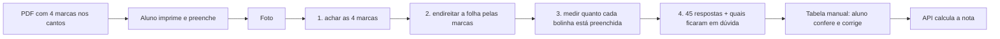
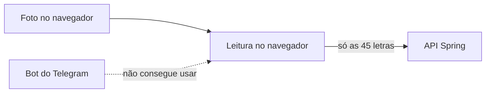
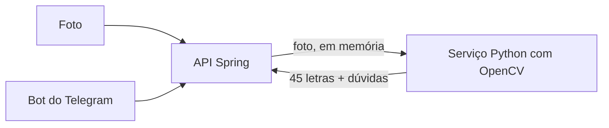
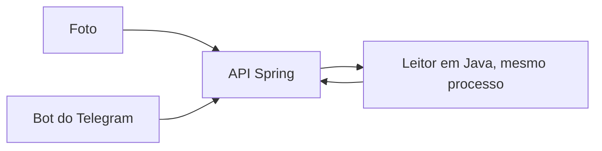

# 0010: onde rodar a leitura do cartão-resposta por foto (e como o bot do Telegram se encaixa)

- **Data:** 09/11/2026
- **Quem participou:** Gabriel (pediu a ideia); rascunho escrito por agente de IA. Murilo ainda não viu.
- **Estado:** **ACEITA PELO GABRIEL em 09/11/2026: opção C (leitura em Java, na própria API), com PDF fixo pronto. Aguardando o ok do Murilo.** Telegram continua fora desta rodada. A foto é uma camada de fora (regra de corte do `AGENTS.md`).

## Decisão do Gabriel (09/11/2026)
- Seguir a **opção C**: o leitor da foto roda em Java dentro da API (`POST /api/read-card`), com o cartão em **PDF fixo** já pronto (`public/cartao-resposta-mt-2025.pdf`, gerado por `data/make_answer_card.py`).
- Ele **aceita que a foto saia do aparelho**, com uma condição que vale como regra de código (a mesma da [0003](0003-onde-roda-o-calculo-e-privacidade.md)): **a API não guarda nada e não registra nem a foto nem as respostas lidas.** Na prática: a foto fica só na memória durante a chamada, o Spring é configurado para não gravar o envio em arquivo temporário, e há teste automatizado que confere que nada da foto nem das respostas aparece no log.
- O texto público (README, página do site e página do design) passa a dizer: se o aluno enviar a foto, ela viaja até a API, é lida na memória e descartada.
- Ainda **não** vale: o aluno sempre confere as respostas lidas na grade antes de calcular; Telegram não foi construído; o que a leitura acerta em foto de celular de verdade **ainda não foi medido** (só com fotos sintéticas).

## Problema
O Gabriel quer que o aluno **imprima um cartão-resposta em PDF** gerado pelo Paideia, com **marcas de alinhamento nos cantos**, preencha, **tire uma foto** e tenha as 45 respostas **lidas automaticamente**. A mesma foto também poderia ser enviada a um **bot do Telegram**.

Quem é afetado: o aluno que fez a prova no papel e não quer digitar 45 letras. Hoje a entrada é a tabela manual (leva tempo e dá erro de digitação; **ainda não medi** quanto: dá para cronometrar 3 pessoas digitando, igual à linha M1 de `docs/metricas.md`).

A decisão [0003](0003-onde-roda-o-calculo-e-privacidade.md) diz que o cálculo roda na API e que **não guardamos nada**. Foto muda esse quadro: se a leitura rodar fora do navegador, **a foto inteira sai do aparelho**, o que é bem mais do que 45 letras. O texto público precisa dizer exatamente o que acontece.

## Como a leitura funciona (igual nas três opções)

- As marcas dos cantos dão os quatro pontos conhecidos para **endireitar a foto** (correção de perspectiva). Como nós desenhamos o cartão, a posição de cada bolinha na folha é conhecida e fica num arquivo único de medidas usado pelo gerador do PDF e pelo leitor.
- Em cada bolinha mede-se a **fração escura**. Acima de um limite é "marcada". Sem nenhuma marcada é "branco"; duas ou mais é "dupla" (conta como erro, como no ENEM).
- **O resultado vai para a tabela manual antes de calcular.** A foto é uma ajuda para preencher, não um passo sem volta: o aluno corrige o que a leitura errou. Isso protege a nota (R5) e é o plano B quando a foto falha.
- Se não achar as 4 marcas, a leitura **recusa** e pede outra foto (melhor que chutar).

## Alternativas consideradas (trade-offs)
Critérios usados: heurísticas 1 (núcleo na stack que a pessoa domina), 2 (demo no ar vale mais que tecnologia nova) e 4 (corte da camada externa) de `docs/agents/workflow.md`.

### Opção A: no navegador (OpenCV.js ou código próprio em JavaScript)

- **Esforço:** médio a alto. OpenCV.js é uma biblioteca grande carregada no navegador (o tamanho **não medi**; seria preciso medir o peso e o tempo de carregamento em celular simples). Há alternativa mais leve: como o cartão é nosso, dá para escrever só o que precisamos (achar quadrados escuros, uma transformação de perspectiva, medir bolinhas) com a API de `canvas` do navegador, sem OpenCV.
- **Risco:** desempenho e memória em celular barato (não medi). Depurar visão computacional no navegador é mais lento. O código de leitura fica em JavaScript, longe do núcleo em Java.
- **Privacidade:** a melhor das três. **A foto não sai do aparelho**; só as 45 letras vão para a API, como hoje.
- **Telegram:** **não encaixa.** O bot precisa receber a foto e lê-la no servidor, então a leitura teria que existir uma segunda vez (outra linguagem). Dois leitores para manter e comparar.

### Opção B: serviço em Python (OpenCV) chamado pela API Spring

- **Esforço:** médio para a leitura (OpenCV em Python já traz tudo pronto e o Gabriel conhece Python), mais o trabalho de **colocar um segundo serviço no ar**: outro contêiner, outra URL, autenticação entre os dois e mais um ponto que pode cair na demo.
- **Risco:** a hospedagem da API ainda nem foi decidida (0006). Dois serviços dobram esse risco e podem esbarrar nos limites dos planos gratuitos (não verifiquei). A latência soma um salto de rede. Quebra a heurística 2.
- **Privacidade:** a foto vai do aparelho até **o nosso servidor** e depois ao serviço Python. Precisamos garantir: processar **só em memória**, nunca gravar em disco, nenhum log com a imagem ou o resultado, limite de tamanho, e que o serviço Python não seja acessível de fora (só a API chama). Atualiza a 0003: "a API calcula e **a foto é lida e descartada**".
- **Telegram:** bom. O bot (em qualquer linguagem) baixa a foto e manda para a API, que repassa ao leitor. Uma leitura só para web e bot.

### Opção C: direto em Java, dentro da API

- **Esforço:** médio a alto. Duas rotas: a biblioteca OpenCV para Java (precisa de código nativo no servidor, o que pode complicar a hospedagem e o CI, não verificado) ou **Java puro** (`BufferedImage`): achar as 4 marcas, resolver a perspectiva com 4 pontos (um pequeno sistema de equações) e medir as bolinhas. Como o cartão é controlado por nós, o Java puro parece viável, mas **não testei**; é o item mais incerto da estimativa.
- **Risco:** menos ferramentas prontas que no Python, e a primeira leitura pode demorar a ficar boa. Em compensação: um serviço só, sem nada novo para hospedar. Pode seguir o mesmo método do motor da TRI: protótipo de referência em Python em `data/` (para afinar limites rápido) e o Java reproduzindo os resultados nos mesmos casos de teste.
- **Privacidade:** igual à B (a foto chega ao nosso servidor), com um ponto a menos de exposição por não ter um segundo serviço. Mesmos cuidados: só em memória, sem log da imagem, limite de tamanho, texto público atualizado.
- **Telegram:** bom. O bot chama a mesma função de leitura. Uma leitura só para web e bot, na linguagem do núcleo.

### Resumo
| | A: navegador | B: Python + API | C: Java na API |
|---|---|---|---|
| Esforço (palpite, não medido) | médio-alto | médio + segundo serviço | médio-alto |
| Hospedagem nova | nenhuma | **um serviço a mais** | nenhuma |
| A foto sai do aparelho? | **não** | sim, vai ao nosso servidor | sim, vai ao nosso servidor |
| Guardamos a foto? | não | não (só memória, a garantir no código) | não (só memória, a garantir no código) |
| Serve ao bot do Telegram | não (leitor duplicado) | sim | sim |
| Risco principal | celular fraco, peso do OpenCV.js | dois serviços, 0006 aberta | pouca biblioteca pronta, nativo no servidor se usar OpenCV |

## Como o bot do Telegram se encaixa (só desenho, nada criado)
- O Telegram é uma **entrada a mais**, igual à foto no site: o aluno manda a foto ao bot, o bot baixa a imagem, chama a mesma leitura e responde com as 45 letras lidas e, depois da confirmação do aluno, o mapa de erros.
- **Token do bot só em variável de ambiente** (nome em `.env.example`, valor nunca no repositório; R1). Quem cria o bot e guarda o token é o Gabriel ou o Murilo, pelo BotFather; **este rascunho não cria bot nem pede token**.
- **Long polling** (o programa pergunta ao Telegram "tem mensagem nova?" em vez de esperar o Telegram chamar o programa) **serve para a demo local**: não exige endereço público com HTTPS. Webhook só se houver hospedagem fixa.
- **Privacidade no Telegram é diferente:** a foto passa pelos servidores do Telegram, que é terceiro e fora do nosso controle. O bot deve dizer isso antes de receber a foto e apagar o arquivo baixado logo após ler. Não dá para prometer "nada sai do aparelho" nesse canal.
- Se o prazo apertar, o Telegram é a **primeira camada a cortar** (proposta v2 de 09/11).

## Como medir a taxa de acerto da leitura (antes de prometer qualquer número)
1. **Conjunto de teste com resposta conhecida.** Gerar cartões com respostas **fictícias** (sorteadas, como nos casos de teste da TRI), imprimir, preencher a caneta exatamente como o sorteio, e fotografar. Sem nome nem dado pessoal no cartão (R3).
2. **Variar as condições**: luz boa e ruim, sombra, folha torta, folha levemente dobrada, caneta azul e preta, marcação fraca, rasura, foto de celular simples. Anotar a condição de cada foto.
3. **Contas:** (a) **taxa por cartão** = cartões com as 45 respostas certas, dividido pelo total; (b) **taxa por bolinha** = respostas certas, dividido por 45 vezes o número de cartões; (c) **tipos de erro**: marcada lida como branco, branco lido como marcada, dupla; (d) **recusadas** = fotos em que as marcas não foram achadas, contadas à parte (recusar é melhor que errar).
4. **Tamanho mínimo:** com poucas fotos o número engana. Combinar com o time um mínimo (sugestão: 30 fotos em condições variadas) e **mostrar quantas foram testadas ao lado da taxa**, nunca a taxa sozinha.
5. Registrar em `docs/metricas.md` numa linha nova (hoje **ainda não medi**), com "antes" = tempo de digitar a tabela à mão e "depois" = tempo de fotografar e conferir.
6. Para o aluno: sempre mostrar o resultado da leitura na tabela para conferir. O número que importa ao jurado é "leu certo em X de N cartões testados", dito com o tamanho da amostra.

## Recomendação
**Opção C (Java na própria API), começando por Java puro e um cartão que nós desenhamos**, com o Python só como protótipo de referência em `data/` se a afinação ficar lenta.
- Heurísticas 1 e 2: o núcleo continua na stack do time e **não aparece um segundo serviço** para hospedar (a 0006 ainda está aberta).
- Serve ao Telegram sem duplicar a leitura.
- Trade-off aceito: a foto sai do aparelho, e isso **precisa estar escrito** no texto público e na 0003 ("a API lê a foto na memória e a descarta"; sem gravar, sem log). Se a privacidade forte for prioridade, a opção A é a única que mantém a foto no aparelho, ao custo de não servir ao bot.
- Plano de corte: primeiro a leitura no site, com confirmação na tabela; Telegram só depois; se o tempo acabar, a tabela manual segue sendo o núcleo.

## Para decidir (perguntas)
1. Aceitamos que a foto saia do aparelho (opções B e C), com texto honesto, ou a privacidade forte da A vale perder o bot?
2. Gerar o PDF do cartão: no navegador, no Java ou um PDF fixo pronto? (Um PDF fixo é o mais barato para começar.)
3. Quantas fotos de teste conseguimos juntar até 19/11, e com quais celulares?
4. Isto cabe no prazo depois do núcleo estar no ar? Se não, cortamos o bot e deixamos a foto só no site.

## Colaboração
Ideia do Gabriel; rascunho e comparação por agente de IA. Murilo revisa.

## Resultado com evidência
Ainda não medi nada. Como medir: seção acima.

## Aprendizado
A preencher depois da decisão e do primeiro teste de leitura.
