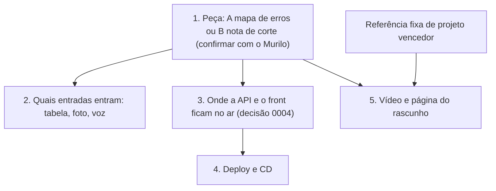

# Resumo do dia: 05/11/2026

## Feito hoje
- **Regras dos agentes:** `AGENTS.md` com R1 a R11, prioridades de esforço e mapa único de pastas conferido por `scripts/check-structure.sh`.
- **Travas automáticas:** hook de gitleaks (R1), hook de mensagem de commit sem IA como coautora (R4) e CI `guardrails` (verde).
- **Fluxo de trabalho** (`docs/agents/workflow.md`): gancho de história, heurísticas de decisão, visualização, sincronização, planejamento antes de decidir e este fechamento do dia.
- **Registros:** `docs/metricas.md`, `docs/referencias.md` e `docs/arquitetura.md`.
- **Decisões:**
  - [0001](../decisions/0001-java-21-spring-boot-4-1.md): Java 21 + Spring Boot 4.1.2 (o Murilo trocou do Java 25).
  - [0002](../decisions/0002-front-na-raiz-java-em-server.md): front na raiz, Java em `server/`.
  - [0003](../decisions/0003-onde-roda-o-calculo-e-privacidade.md): cálculo na API que não armazena as respostas.
- **README:** o Murilo escreveu a primeira versão. O Gabriel ajustou só a linha de privacidade, de acordo com a 0003.

## Números medidos
Nada medido hoje. As linhas M1 a M4 de `docs/metricas.md` seguem como "ainda não medi".

## Decisões pendentes, em ordem de dependência

- **Peça A ou B:** a hipótese de trabalho é a A. O Murilo respondeu "pode ser a A" sobre a decisão 0003; falta confirmar se ele vale também para a peça.
- **Rascunho:** o regulamento não menciona rascunho e a promessa de créditos veio só da live. Confirmar no painel ou em oi@hackbrasil.com.

## Em andamento com
| Quem | O quê |
|---|---|
| Murilo | Ajustes do `README.md` (funcionalidades como "planejado", Vercel e Python "a definir", remover "Trilha 03", consertar o `git clone`) e pesquisa de hackathons anteriores |
| Gabriel | Disponibilidade reduzida em 08/11 e 15/11 (ENEM) |

## Próximos passos
1. Confirmar a peça (A ou B) com o Murilo.
2. Murilo corrige o README; Gabriel revisa.
3. Testar a hospedagem da API cedo e registrar como decisão `0004`.
4. Conferir no painel o que o rascunho exige e o prazo.
5. Escolher uma referência fixa de projeto vencedor, com o material da pesquisa do Murilo.
