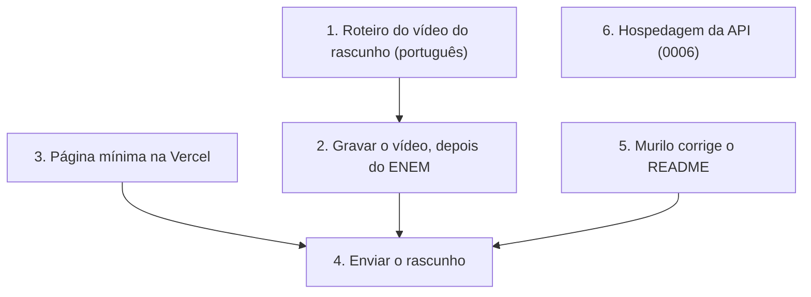

# Resumo do dia: 06/11/2026

## Plano do dia
- **Onde paramos:** peça e stack definidas; papéis (0004) e pacotes (0005) pendentes.
- **Tempo de hoje:** Gabriel, cerca de 30 min (estimativa dele, sem registro). Véspera do ENEM (08/11).
- **Resultado de hoje, em uma frase:** fechar peça, papéis, pacotes, página e idioma do código.

## Feito hoje
- **Peça confirmada pelos dois:** mapa de erros da TRI.
- **Rascunho conferido no painel:** pede trilha, repositório público, vídeo de cerca de 3 min com cada integrante na câmera e página pública em HTTPS. A organização revisa para liberar os créditos por integrante, sem bloquear a submissão final. Detalhes em `docs/referencias.md`.
- **Decisões:**
  - [0004](../decisions/0004-divisao-de-papeis.md): papéis flexíveis (opção D).
  - [0005](../decisions/0005-dependencias-pacotes-spring.md): `br.com.paideia` e `paideia-backend`.
  - [0007](../decisions/0007-pagina-publica-na-vercel.md): página pública na Vercel, no mesmo repositório.
  - Código em inglês e vídeo do rascunho em português (convenção no `AGENTS.md`).
- **Numeração:** a hospedagem da API passa a ser a 0006 (a 0005 ficou com os pacotes).

## Tempo juntos
Ainda não registrado: as combinações de hoje foram por mensagem.

## Números medidos
Nada medido hoje.

## Decisões pendentes, em ordem de dependência

## Em andamento com
| Quem | O quê |
|---|---|
| Murilo | Roteiro do vídeo, depois a página; ajustes do README; pesquisa de hackathons anteriores |
| Gabriel | Falas do vídeo e texto da página; cidade e UF no painel |

## Pendências de documentação
- Prazo do rascunho: não aparece no painel.
- Entrevistas com alunos (M5): 0 feitas; melhor depois do ENEM.

## Próximos passos
1. Fechar o roteiro do vídeo e dividir as falas.
2. Criar a página mínima na Vercel (a conta é do Gabriel).
3. Murilo corrige o README antes do envio.
4. Descobrir o prazo do rascunho (painel ou oi@hackbrasil.com).
5. Testar a hospedagem da API cedo (0006).
