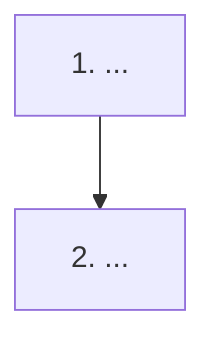

# Resumo do dia: AAAA-MM-DD

## Feito hoje
-

## Tempo juntos
Só horas reais. Sem medida, escreva "ainda não registrado".

| Início | Fim | Horas | Onde (Discord, WhatsApp, Meet) | Por quê | Problema que ia resolver | O que saiu |
|---|---|---|---|---|---|---|
| | | | | | | |

## Números medidos
Nada medido, ou liste as linhas de `docs/metricas.md` que mudaram.

## Decisões pendentes, em ordem de dependência

## Em andamento com
| Quem | O quê |
|---|---|
| | |

## Evidências (prints)
Antes de tirar: o outro concordou em aparecer? Telefone e nome ocultos (R3)? Nunca incluir código de acesso, senha ou token (R1).

| Nº | O que mostra | Estado (a tirar, tirado, revisado) | Arquivo em `docs/evidence/screenshots/` |
|---|---|---|---|
| | | | |

## Entrevistas em aberto
Perfil sem nome. Conta em M5 de `docs/metricas.md`.

| Nº | Data | Perfil | Perguntas | Resposta resumida |
|---|---|---|---|---|
| | | | | |

## Pendências de documentação
-

## Próximos passos (máximo 5, em ordem)
1.
